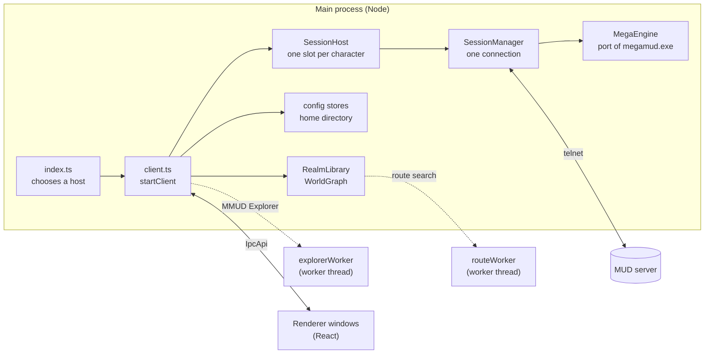

# Architecture

## Processes

Everything that touches the game runs in **main**: sockets, parsing, the
engine, the world graph, every file. The **renderer** is a view: it is told
what to draw by pushes and asks for things by calls, all through the
contract in `src/shared/ipc.ts`. Two **worker threads** keep slow searches off
main's thread, where they would freeze the socket: route planning
(`world/routeWorker.ts`, behind `RoutePlanner`) and MMUD Explorer's sums
(`mme/explorerWorker.ts`, behind `ExplorerThread`).

## Two hosts, one client

`src/main/index.ts` picks a host and starts the client on it:

- **Desktop** (`host/ElectronHost.ts`): Electron windows, the preload bridge
  (`src/preload/index.ts`) and Electron's IPC.
- **Browser** (`host/WebHost.ts`, chosen by `MUDENGINE_WEB=1`): an HTTP server
  serving the built renderer, a password sign-in (`host/web/access.ts`), and
  one WebSocket per tab carrying the same contract (`shared/rpc.ts` is the
  envelope). The renderer finds no preload bridge and builds the same object
  over the socket (`renderer/src/lib/webBridge.ts`). This is how the Docker
  image runs, and `npm run web` runs it outside Docker.

  **A tab outlives its socket.** Everything main sends a tab is numbered and
  held until the tab acknowledges it (`host/web/link.ts`), and everything the
  tab sends is numbered and taken once. A tab that dials again says hello as
  itself and is sent what it missed (`host/web/tabs.ts`,
  `renderer/src/lib/webLink.ts`), so nothing on its screen is redrawn. It is
  kept for `tuning.web.resumeMs`, up to `resumeBytes`; past either, or when
  the client restarted, it comes back as a new window and remounts. A beat
  each ping sweep lets the page notice a link the browser still shows open.
  Character and automation pushes go as the fields that changed
  (`host/web/patches.ts`), deflated where the browser offers it, and a page
  holding another build's code reloads onto the running one. Each tab's link
  and how it fared go to `logs/web.log`.

`client.ts` never learns which host it has. Whatever differs (windows, a file
picker, the clipboard, revealing a file) is a duty of the `Host` interface
(`host/Host.ts`), and a host that cannot do something says so. Only
`ElectronHost.ts` imports `electron`, and the hosts are imported dynamically
in `index.ts`, because a static `electron` import fails under plain Node
before any code runs.

## Sessions belong to the app, not to a window

A window shows sessions; it never owns one. Closing a window must not touch a
socket. Three classes keep this straight:

- `session/SessionHost.ts` holds every loaded session, one slot per
  character, and is the only thing that creates or destroys one. Each slot's
  publishing sink closes over its session id, so every push is addressed.
- `windows/WindowRegistry.ts` knows which windows are attached to which
  sessions, and routes pushes in four tiers: raw terminal data only to
  windows showing that session (`toAttached`), framed lines only to those
  also showing the Stream card (`toDiagnostics`), debug records only to the
  debug view (`toDebugging`), and the low-rate state (character, connection,
  walk, automation) to every window (`toAll`).
- `windows/Workspace.ts` knows which window's tab rail owns each character
  (one window per character), saved in `workspace.json`.

## Source directories

| Directory | What is in it |
|---|---|
| `src/main/index.ts`, `client.ts` | The entry point, and the client: every store, the realm data, the sessions, and the handler behind every IPC call (`client.ts` is about 4,200 lines). |
| `src/main/app/` | Process-wide facts: the home directory (`home.ts`), one client per home (`homeLock.ts`), the UI dictionary for main (`i18n.ts`), `tuning` (`tuning.ts`), quitting. |
| `src/main/host/` | The two hosts and the web server, sockets and sign-in. |
| `src/main/net/` | Telnet: the socket (`TelnetClient`), the protocol parser (`TelnetParser`), line framing (`LineTokenizer`), the terminal's quirks and the cursor-position answer. |
| `src/main/parse/` | Our reading of the stream: `Classifier` (line to block, by `patterns.ts`) and `CharacterTracker` (blocks to `CharacterState`), with its clusters split out (inventory, combat, presence, players, expectations, tally). |
| `src/main/session/` | One connection and everything around it: `SessionManager`, `MegaEngine`, the hunting and fight appraisal (`Appraisal`), the terminal feed and rewrites, reconnecting, the link watch, and the records (logs, captures, backscroll, fights, talk, belongings, movement). |
| `src/main/megamud/` | The port of `megamud.exe`'s engine: its session struct, scheduler, line handlers and steps. See [engine.md](engine.md). |
| `src/main/automation/` | What still acts beside the engine: the command queue, the login, auto-hunt, quests, item errands, wards and auto-keys. See [planners.md](planners.md). |
| `src/main/world/` | Realm data: reading `.mdb` and `.zip` (`RealmSource`), converting (`buildRealm`), caching (`RealmLibrary`), the graph and A* (`WorldGraph`), locating the character (`resolve.ts`), and the per-realm memory stores. See [world.md](world.md). |
| `src/main/config/` | The stores for each file in the home, the settings editor behind the Settings screen, and the migrations. See [files-and-settings.md](files-and-settings.md). |
| `src/main/mme/` | MMUD Explorer: mudtool's logic vendored (`vendor/`, by `npm run sync:mme`), the facade over it (`Explorer.ts`) and its worker. |
| `src/main/stats/` | Posting a character's readings to a mudstats board. |
| `src/main/windows/` | The window registry and the workspace. |
| `src/shared/` | Types and pure functions both sides use: the IPC contract, blocks, `CharacterState`, config schema and normalisation, profiles, MegaMUD's settings schema (`shared/megamud/`), routing types, and many small calculators. No Node, no DOM. |
| `src/preload/` | The desktop bridge: `window.mudengine`, the `IpcApi` over Electron IPC. |
| `src/renderer/src/` | The React app: `App.tsx`, `components/` (cards, screens, editors), `hooks/`, `lib/`, `styles/`. See [renderer.md](renderer.md). |
| `resources/` | Shipped data: the options templates, the two bundled worlds (`world/*.jsonl.gz`), the server table's CSVs, MegaMUD's converted loops, the bundled servers, the font. |
| `locales/ui.en.yaml` | Every word the UI and main's notices show. |
| `scripts/` | Build, packaging, Docker, the gate, smoke tests, probes against a live realm, the capture replay. See [development.md](development.md). |
| `docs/megamud/` | What `megamud.exe` does, read from the binary with addresses, and the plan of the port. |

## Size

About 200,000 lines outside the tests. The largest single files are
`WorldGraph.ts` (9,700), `CharacterTracker.ts` (7,300), `Migration.ts`
(7,000), `App.tsx` (6,400), `SessionManager.ts` (6,100) and `client.ts`
(4,200). `src/shared` alone is 45,000 lines across 78 modules.
