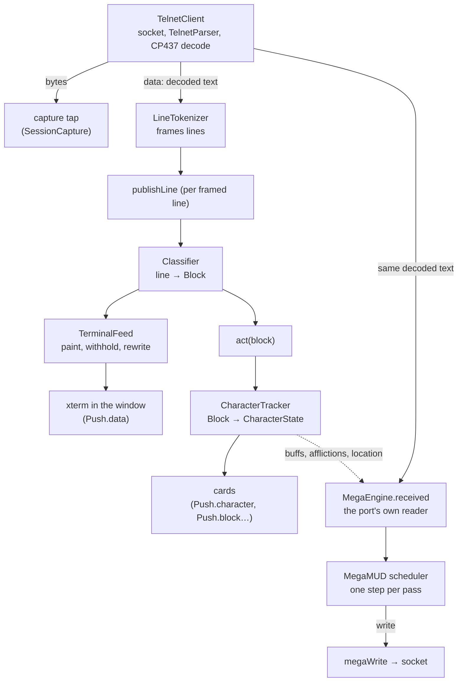

# The session pipeline

One `SessionManager` (`src/main/session/SessionManager.ts`) per connection.
Everything below happens on main's thread, in the order written.

## A chunk arrives

1. **Telnet.** `net/TelnetClient.ts` owns the socket. `TelnetParser` splits
   protocol from payload and answers option negotiation, and the payload is
   decoded from CP437. Two events come out: `bytes` (the raw payload, for the
   capture only) and `data` (decoded text).
2. **Framing.** `net/LineTokenizer.ts` frames the text into lines. A line
   ends at CRLF **or** at the server's in-place status repaint
   (`ESC[79D ESC[K`), which is how the prompt is rewritten. This is the
   single most important parsing fact about the game family. A prompt that
   is complete (ends `]:`) is framed at once; any other unterminated tail is
   framed after a short quiet period (`armIdleFlush`).
3. **Classifying.** For each framed line, `publishLine` records it, pushes it
   to the Stream card (`sink.line`) and asks `parse/Classifier.ts` what it is.
   The classifier tests the plain text against the pattern table
   (`parse/patterns.ts`); colour only adjusts confidence. Multi-line listings
   (inventory, `who`, a room) are collected into a **batch** that closes into
   one block. One framed line may hold several facts (text printed after a
   prompt without a repaint), returned as `tails`.
4. **Painting.** `session/TerminalFeed.ts` decides what the terminal is shown,
   line by line: normally the line as it came, sometimes withheld (the answer
   to a command the client sent quietly) or rewritten into a laid-out listing
   (`shared/rewrites.ts`, filled by `session/Rewriter.ts`). Paints go to every
   window attached to the session (`Push.data`). A parser fault costs a line
   its type, never its paint.
5. **Acting.** `act()` publishes the block (`Push.block`), then
   `CharacterTracker.apply` folds it into `CharacterState`, a pure reducer
   over blocks with about seventy cases. A changed state is published
   (`Push.character`), every change, never coalesced, because the renderer's
   alerts are read off consecutive states. A prompt also credits the old
   command queue (below).
6. **The engine.** After our own reading, the same decoded text goes to
   `MegaEngine.received`. The engine first gets the buffs and afflictions
   our tracker read, then the port's own reader (`megamud/input/ParseData.ts`,
   MegaMUD's `0x479630`) frames the text again, character by character with
   colours, dispatches each line to MegaMUD's line handlers, and at the end of
   a chunk that leaves nothing unfinished runs MegaMUD's scheduler
   (`megamud/script/scheduler.ts`). Each scheduler pass does at most one
   thing: the first step that sends ends the pass.

So the stream is read **twice**: by our classifier and tracker, for the
screen, the cards, routing and the records; and by the port, for every
decision. Where the two must agree on a fact (where the character is, what is
up on it) the engine is told what our tracker read: `located()` when the
tracker places the room, `buffs()` and `afflictions()` each chunk.

The engine also runs on two clocks of its own, set up in `MegaEngine`: a
one-second tick (`secondTick`, MegaMUD's `WM_TIMER`) and the quiet tick
(`quietTick`), which runs the scheduler and MegaMUD's silence handlers when
nothing is arriving.

## A command goes out

There are three ways a command reaches the socket, and a fourth that feeds
the engine's:

| Path | Who uses it | How it is sent |
|---|---|---|
| `SessionManager.send` | the player's keystrokes (`typedInput`) | at once, after `splitOntoChannel` keeps a pasted run on the channel already typed |
| `megaWrite` | the MegaMUD engine | at once, unless the player has a half-typed line, when it is held until that line is sent or abandoned (`queue.abandonedLineMs`) |
| `CommandQueue.enqueue` | the login automator, macros and toolbar presses (`priority: 'user'`) | flow-controlled: at most a window of commands in flight, credited back by prompts |
| `keptQueue` | wards, auto-keys, quests, item errands, card probes (`ask`) | onto MegaMUD's pending list (`MegaEngine.queue`, `0x48ab60`), which the engine's scheduler sends when it may, and which holds its walk until it is empty |

Every command sent, whichever path, is told to the tracker and the classifier
(`observeCommand`), so a room can be placed by the move that led to it and an
answer told from noise, and to the capture and the session log with whether
the player or automation sent it.

The engine's own sender (`megamud/script/send.ts`) remembers each command
until the realm echoes it, and reads no answer before the echo. This is one
of the places the port answers differently from MegaMUD on purpose; see
[`engine-port.md`](../megamud/engine-port.md), *Where we answer differently*.

## Records taken along the way

Each is a consumer of the same sink, never a second pipeline:

- `SessionLog`: the decoded session as text, for a person to read.
- `SessionCapture`: `.mudcap.jsonl`, raw bytes, decoded text, framed lines,
  commands, the player's actions in the app (`act`), and the engine's own log
  (`engine`: steps, what it is doing, gate changes). Replayed by
  `npm run replay` ([development.md](development.md)).
- `Backscroll`: the terminal's retained output, so a window that attaches
  later, or a client restarted, shows what happened.
- `SessionDebug`: the live trace behind the debug view.
- `FightLog`, `TalkLog`, `Belongings`, `MovementBook`: per-character records,
  see [files-and-settings.md](files-and-settings.md).

## Connection lifecycle

- `connect(target)` dials through `TelnetClient`. `automation/LoginAutomator.ts`
  answers the BBS menus and the login prompts from the server's login script
  and the profile's account.
- `session/LinkWatch.ts` notices a connection that has died without the
  socket closing (a keep-alive that is never answered).
- `session/Reconnect.ts` dials back a connection that was lost rather than
  ended. It stands down where MegaMUD's own redial is on.
- `disconnect(by)` records who ended it, so a lost link and a player's
  Disconnect are told apart.
